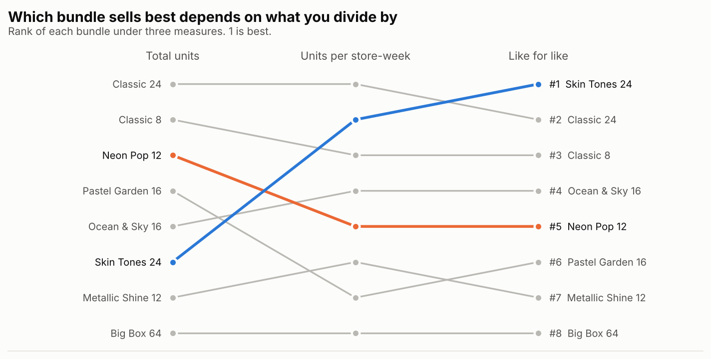
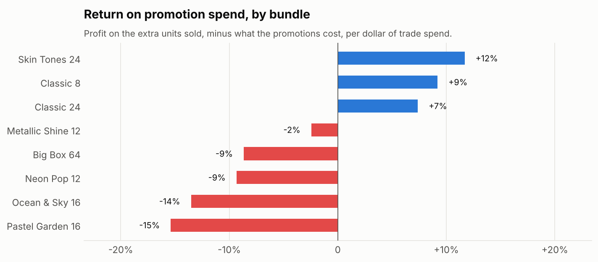
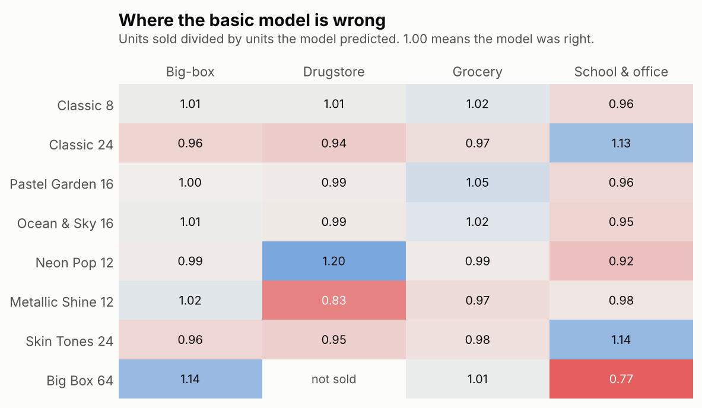
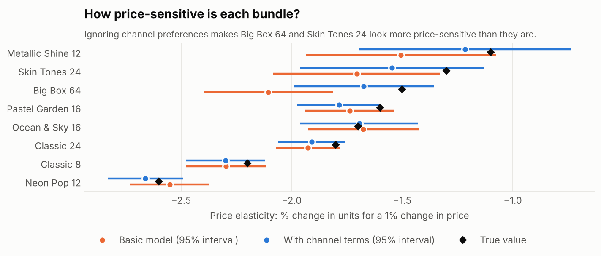

# Which crayon bundles sell more?

**A sales study on fake data with a known answer: why "best seller" depends on what you divide by, and what a fair comparison looks like.**

A fictional crayon maker sells eight bundles through 60 stores and asks which ones sell more. The sales report gives one answer. Units per store gives another. A model that compares every bundle in the same stores, in the same weeks, at list price and with no promotion gives a third, and only that one matches the truth hidden in the data.



> **All data is synthetic.** Tallow Creek Crayon Co., its stores and every number are invented. Because the data is generated, the true demand behind it is known and saved in `data/answer_key/`. The analysis never reads it; it is used only to check the answers at the end.

## Findings

**1. The best-selling bundle is the one the sales report ranks sixth.** Skin Tones 24 launched in September 2024, sits on 30 of 60 shelves, mostly in small stores. Like for like it sells about **9.3 boxes per store-week, against 8.0 for Classic 24**, the report's #1, and the intervals don't overlap. It also earns the most margin per shelf: about $12 per store-week, roughly 40% more than Classic 24.

**2. Neon Pop 12's #3 sales rank is bought.** It was promoted in 16% of its weeks, the most of any bundle. Like for like it is fifth, and its promotions lose about 9 cents per dollar of trade spend.

**3. Most promotions don't pay, and the trade terms decide which do.** Counting the extra units each promotion sold over what the same store would have sold that week at the regular price, only Skin Tones 24 (+12%) and the two Classic sets (+9%, +7%) return more than they cost. Under slightly better terms (no display fee, or 35% of the discount funded instead of 50%), every bundle's promotions at least break even.



**4. The naive way to measure promotions overstates them by 0.4 to 0.8.** Promotions were planned into back-to-school, so "promoted weeks sold more" partly credits the promotion with the season.

**5. Putting Skin Tones 24 on every shelf is worth up to about 17,400 boxes and $22,700 of gross profit a year**, before cannibalization of Classic 24, which this study doesn't model. Treat it as the case for a controlled test, not a forecast.

## The model, and the part where it was wrong

A Poisson regression on weekly units with store effects (each store's traffic), week effects (the crayon calendar), bundle effects (what we want), bundle × season terms, a price elasticity per bundle, and an end-cap display effect. Standard errors are clustered by store.

The first version assumed each bundle performs the same everywhere relative to a store's traffic. Checking predictions against actual sales by bundle and channel showed it was off by up to 23%, in a clear pattern:



That mattered beyond the ranking. Big Box 64 sells best in big-box stores, which are also the cheapest channel, so the basic model mistook "preferred there" for "buys more when it's cheaper" and overstated its price sensitivity (−2.1 against a true −1.5). Adding a term for each bundle in each channel fixed it:



## How well does it hold up?

The whole study was rerun on **20 freshly generated datasets** (same company and true demand, different stores, promotions and noise), with the same code and no retuning:

| | Total units | Units per store-week | Basic model | With channel terms |
|---|---|---|---|---|
| Rank correlation with the truth | 0.60 | 0.90 | 0.99 | 0.99 |
| Picks the true best bundle | 0 of 20 | 1 of 20 | 20 of 20 | 20 of 20 |
| Elasticity mean absolute error | | | 0.17 | 0.12 |
| Elasticity 95% intervals containing the truth | | | 76% | 91% |
| Like-for-like 95% intervals containing the truth | | | 96% | 84% |
| Promotion ROI with the right sign | | | 99% | 99% |

The channel model is the one to use for prices and promotions. Its like-for-like intervals are too narrow, because it extrapolates to bundle-channel combinations that were rarely or never stocked, and 60 store clusters don't capture all of that uncertainty. The notebook says so instead of hiding it.

## Accounting note

Scan-downs and display fees are payments to a customer. Under ASC 606 and IFRS 15 they are generally a reduction of revenue, not a marketing expense, unless they buy a distinct service at fair value. Net revenue and gross profit in this study follow that treatment.

## Run it

```bash
git clone https://github.com/carolmellobee/crayon-bundle-sales-study.git
cd crayon-bundle-sales-study
python -m venv .venv && source .venv/bin/activate   # Windows: .venv\Scripts\activate
pip install -r requirements.txt

python src/generate_data.py    # rebuild the data in data/ (seed 7)
python src/analysis.py         # print the main tables
python src/robustness.py       # rerun everything on 20 new datasets (several minutes)
pytest                         # 9 checks: data integrity, trade terms, model recovery
jupyter notebook notebooks/crayon_bundle_study.ipynb
```

The notebook is saved with its outputs, so it reads fine on GitHub without running anything.

## Repository

```
data/
  bundles.csv                 8 bundles: prices, wholesale price, unit cost
  stores.csv                  60 stores in 4 channels
  weekly_sales.csv            33,872 store-bundle-weeks: price, promotion, display, units, trade spend
  answer_key/                 the true demand parameters (used only for checking)
src/
  generate_data.py            builds the data
  analysis.py                 naive measures, the model, promotion ROI, what-ifs
  robustness.py               the 20-dataset check
  plots.py                    charts
notebooks/
  crayon_bundle_study.ipynb   the full study
reports/
  figures/                    charts used here
  robustness.csv              per-dataset results
tests/
  test_study.py
```

## Limits

- **The same author wrote the data generator and the model.** Channel effects were added so the model would be wrong in a realistic way, but real demand has more going on: substitution between bundles, stockouts, competitors, retailer pricing rules.
- **No cannibalization.** Each bundle's sales are treated as independent, so the distribution gain is an upper bound.
- **Sell-through is treated as sell-in.** The factory is paid when retailers buy, not when shoppers do.
- **No post-promotion dip.** Shoppers who stock up during a promotion buy less afterwards, which would make promotions look worse than they do here.

## Author

**Carol Mello**, data engineer working on finance and accounting data.
[LinkedIn](https://www.linkedin.com/in/carol-mello-0707352b) · [GitHub](https://github.com/carolmellobee) · [Other tools](https://carolmello.vercel.app/)

Licensed under the MIT License.
